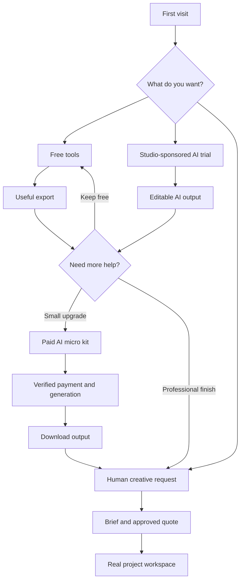
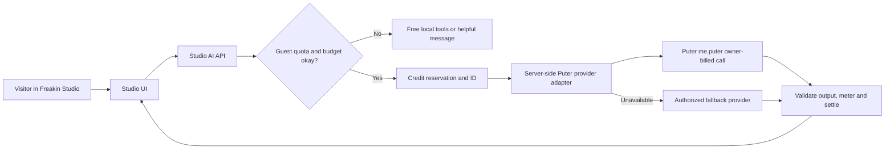
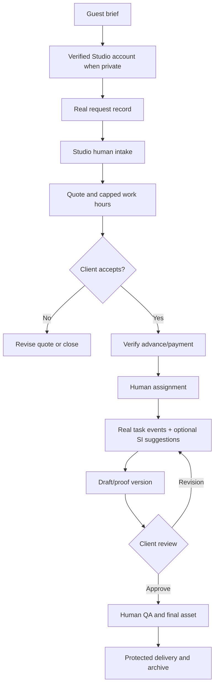
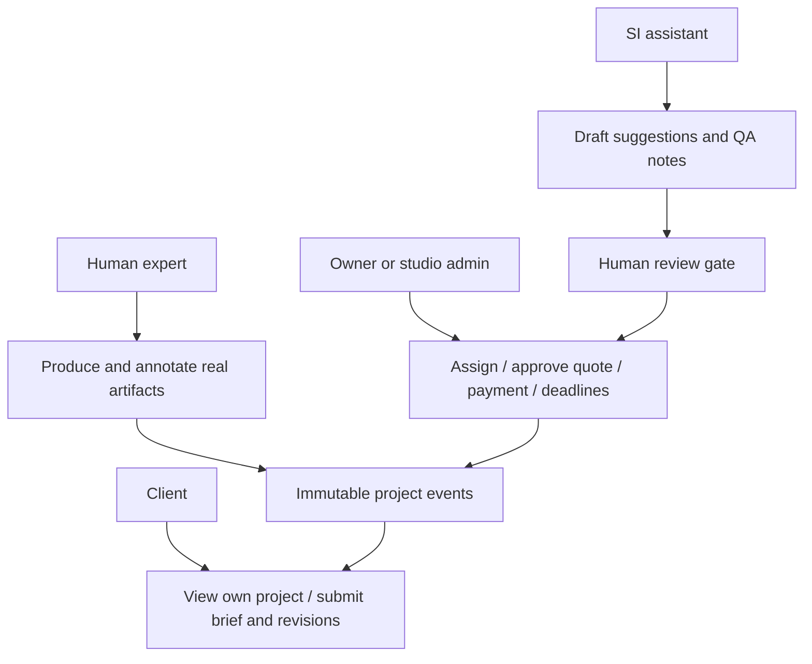

# Creative Office OS 2.0 — Product and Data Flow Diagrams

The diagrams are planning models, not implemented or deployed services.

## 1. User value ladder

## 2. No-Puter-login AI gateway

Tokens and Puter account credentials never flow into Visitor UI. No API route is an unrestricted anonymous inference proxy.

## 3. Client and human office

## 4. Separation of roles

## 5. Proposed two-layer UX

- **Discovery layer:** distinct but accessible “Creative Orbit” where visitors select Free, AI or Human routes.
- **Work layer:** pragmatic controls for money, files, tasks, edits, authorizations and real-time status. No 3D needed in administrative transactions.

## 6. Source-of-truth boundaries

- **Catalog / rates:** approved versioned database data.
- **AI result:** validated provider response with recorded usage and cost.
- **Money:** verified payment provider webhook and immutable ledger.
- **Job progress:** audited project events and task state, never a frontend timer.
- **Private deliverables:** protected storage, signed access, RLS permission checks.
